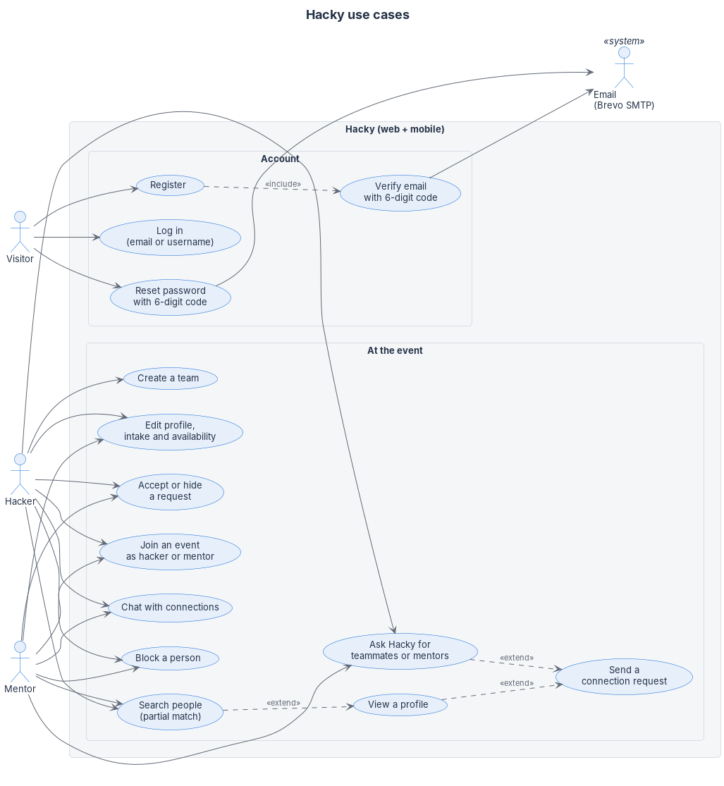
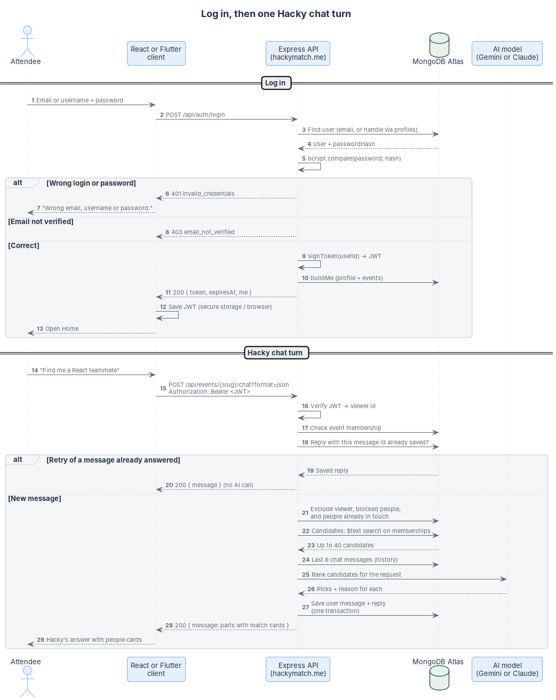
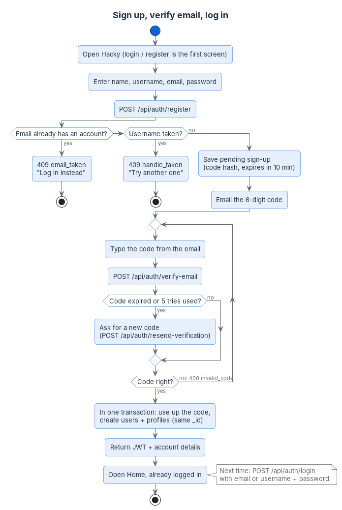
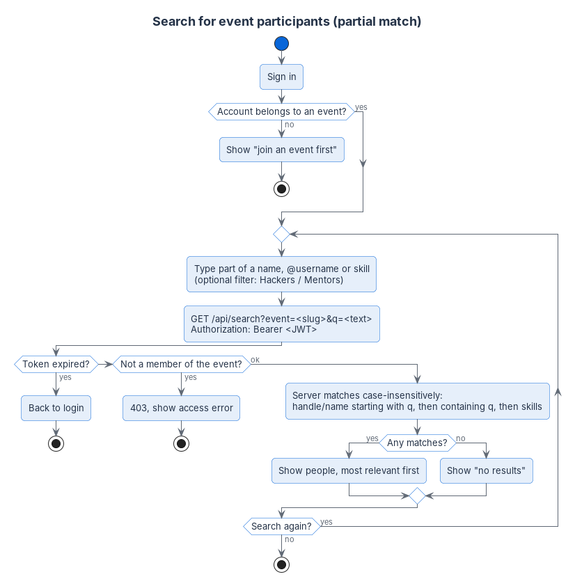
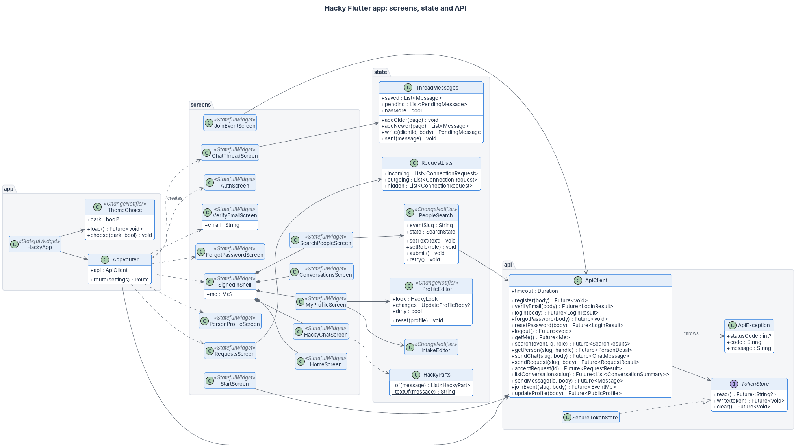
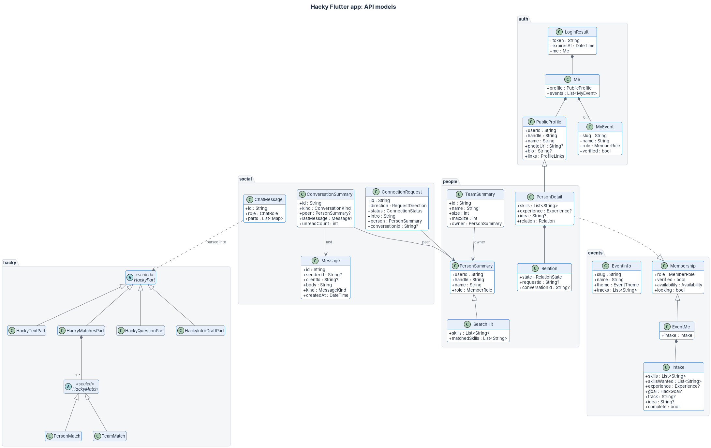

# Diagrams

PlantUML sources (`.puml`) and the rendered images (`.png`) used in the slides. The ERD is in [../erd](../erd). Each diagram is built from the code, so update it when the code it names changes.

| Diagram | Source | Built from |
|---|---|---|
|  Use case | [use-case.puml](use-case.puml) | [openapi.yaml](../openapi.yaml), `web/src`, `mobile/lib/screens` |
|  Sequence: log in + one Hacky chat turn | [sequence.puml](sequence.puml) | `server/src/auth/routes.ts`, `server/src/chat/routes.ts` |
|  Activity: sign up with an emailed code | [activity-signup.puml](activity-signup.puml) | `server/src/auth/routes.ts`, `server/src/auth/codes.ts` |
|  Activity: search people | [activity-search.puml](activity-search.puml) | `GET /api/search` in [openapi.yaml](../openapi.yaml) |
|  Class: Flutter screens, state and API | [class-mobile.puml](class-mobile.puml) | `mobile/lib/**/*.dart` |
|  Class: Flutter API models | [class-mobile-models.puml](class-mobile-models.puml) | `mobile/lib/api/models/*.dart` |

All diagrams share [hacky-style.iuml](hacky-style.iuml) (the app's colors).

## Render

- VS Code: install the PlantUML extension, open a `.puml` file and export it to PNG.
- Command line: `java -jar plantuml.jar -tpng docs/diagrams/*.puml`
- Browser: paste the file at https://www.plantuml.com/plantuml (paste `hacky-style.iuml` in place of the `!include` line).
