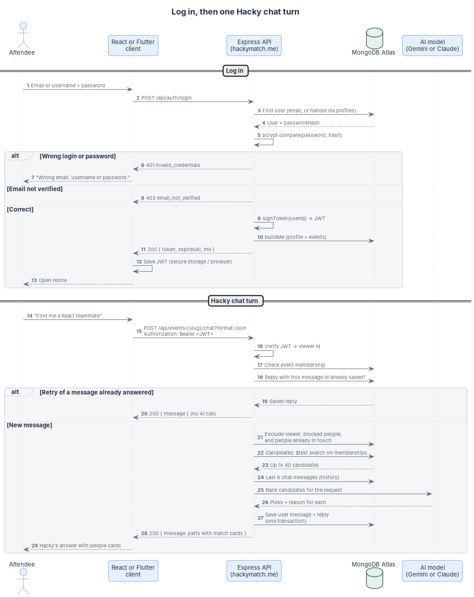
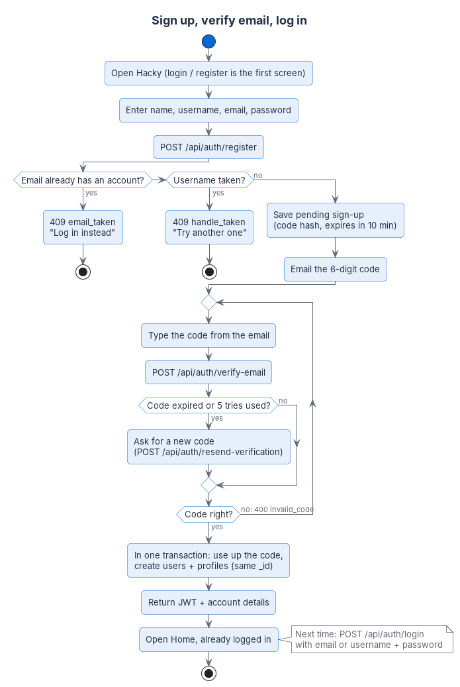
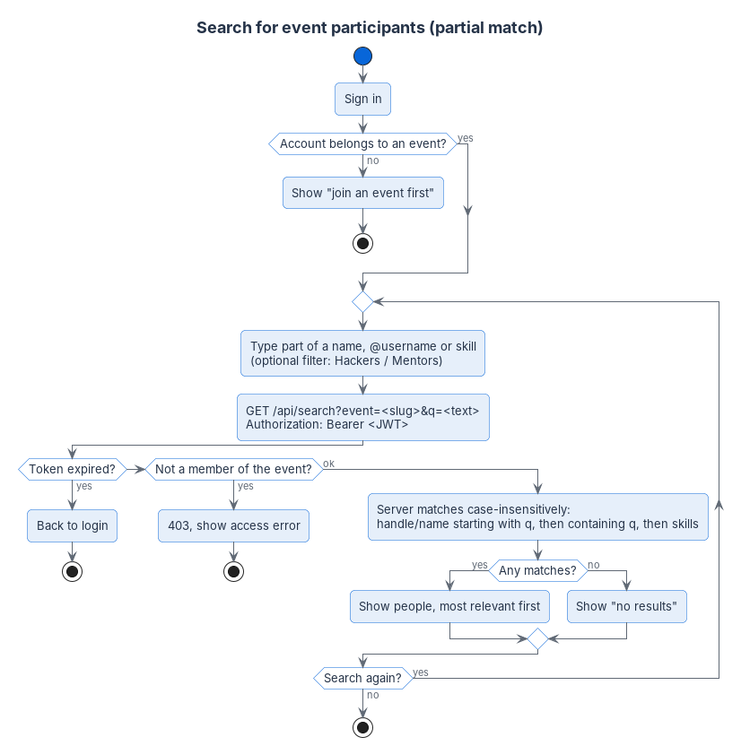
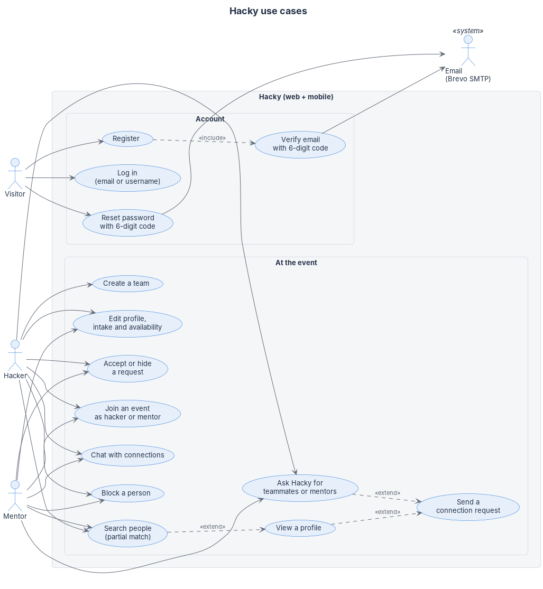

# Hacky interaction diagrams

The API operations and response shapes are defined in [OpenAPI](openapi.yaml).

## Sequence diagram · Log in and one Hacky chat turn

Source: [diagrams/sequence.puml](diagrams/sequence.puml)

## Activity diagram · Sign up with an emailed code

Source: [diagrams/activity-signup.puml](diagrams/activity-signup.puml)

## Activity diagram · Search for event participants

Source: [diagrams/activity-search.puml](diagrams/activity-search.puml)

## Use case diagram · Hacky system scope

Source: [diagrams/use-case.puml](diagrams/use-case.puml)

The Flutter class diagrams are in [diagrams/README.md](diagrams/README.md) and the ERD in [erd](erd).
