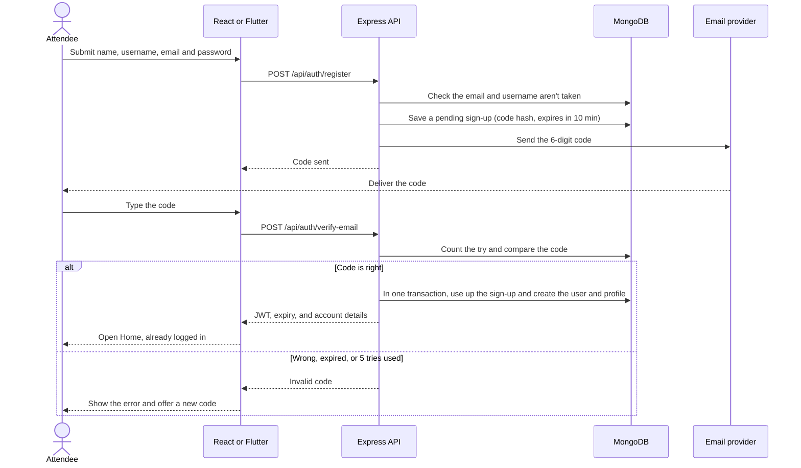
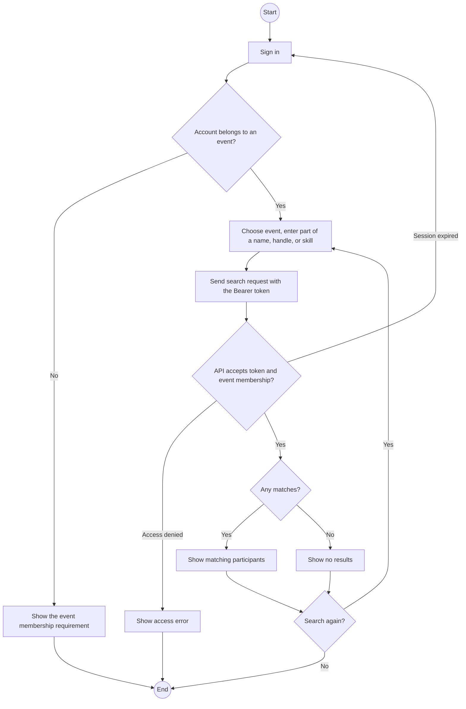
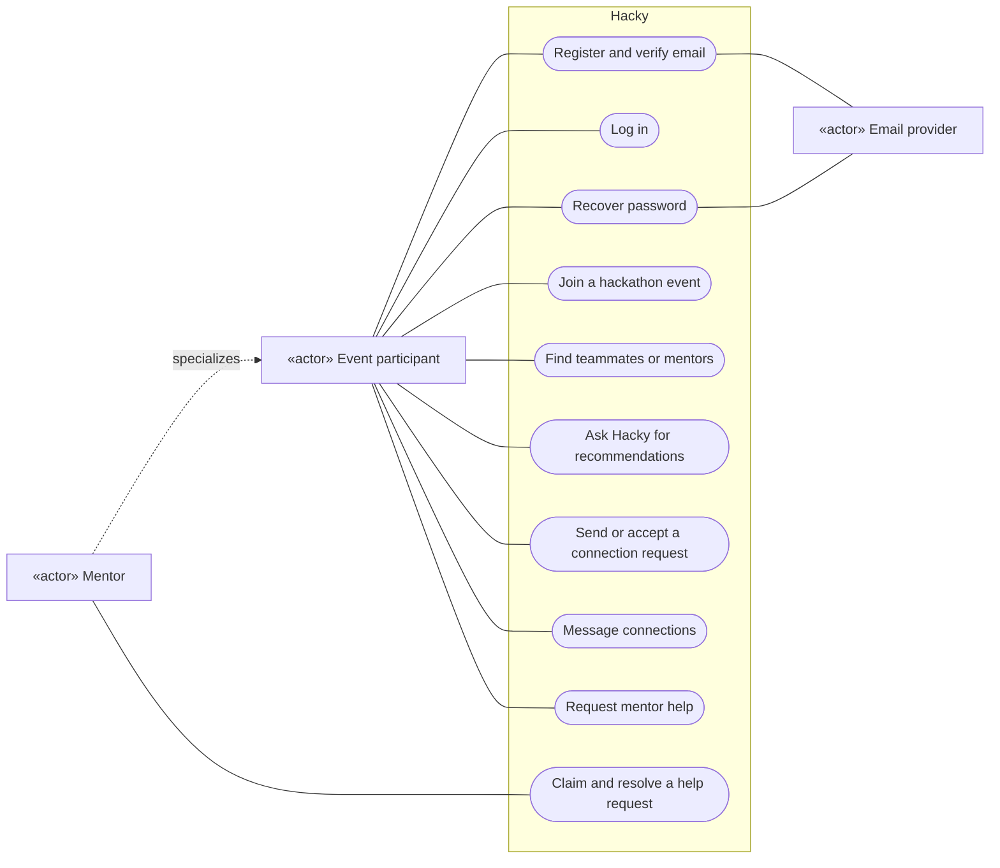

# Hacky interaction diagrams

The API operations and response shapes are defined in [OpenAPI](openapi.yaml).

## Sequence diagram · Registration and first login

An unverified sign-up is deleted after 10 minutes, so it never keeps the email or the username.

## Activity diagram · Search for event participants

## Use case diagram · Hacky system scope

The use cases below describe the project scope in the contract, including features developed by other team members.

