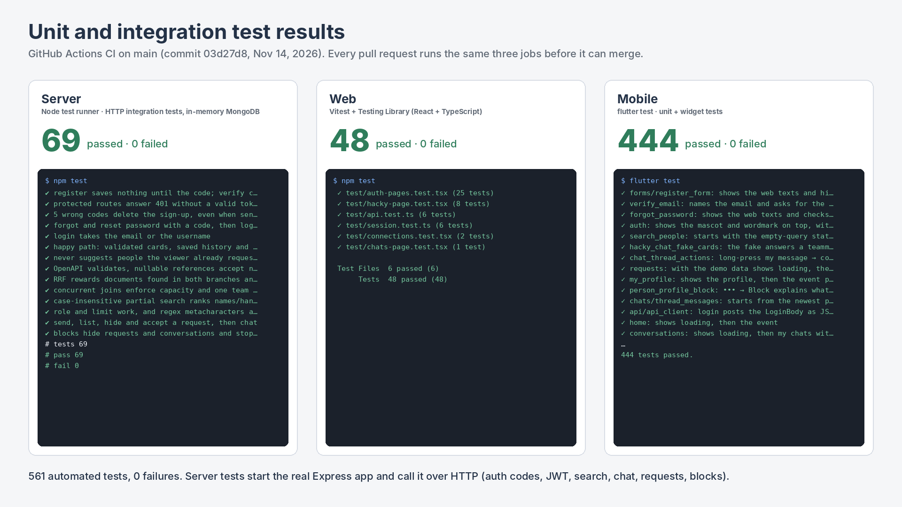

# Test results

From the CI run on `main` after #62 (commit `03d27d8`, Nov 14, 2026): [GitHub Actions run 43644533933](https://github.com/Nickocade14/hacky/actions/runs/43644533933).

| Job | Runner | Tests |
|---|---|---|
| Server (typecheck, build, tests) | Node test runner. Integration tests start the Express app and call it over HTTP against an in-memory MongoDB replica set. | 69 passed, 0 failed |
| Web (build, tests) | Vitest + Testing Library | 48 passed, 0 failed |
| Mobile (analyze, tests) | `flutter test` (unit + widget) | 444 passed, 0 failed |

Every pull request runs the same three jobs before it can merge (`.github/workflows/`). Run them locally with `npm test` in `server/` and `web/`, and `flutter test` in `mobile/`.
